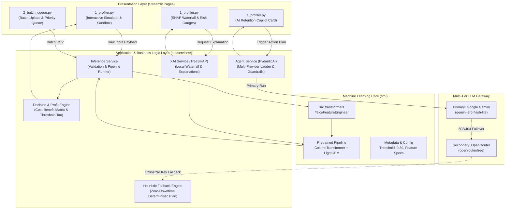
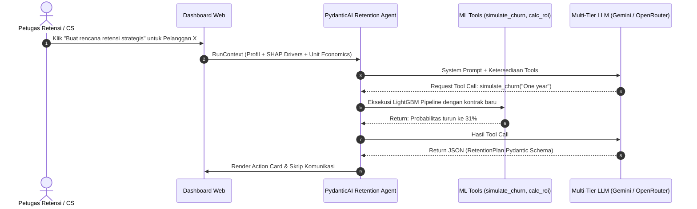

# System Design & Architecture Document: Telco Churn Intelligent Retention Platform (Phase 2)

**Date:** October 2026  
**Status:** Implemented & Fully Operational (Production-Ready)  
**Target Project:** `Telco Churn Classification & Decisioning`  

---

## 1. Executive Summary & Vision

Pada **Fase 1**, repositori telah distandarisasi ke tingkat kesiapan produksi (*production-grade*):
1. Seluruh transformasi fitur dienkapsulasi dalam modular `src/transformers.py` yang bebas dari kebocoran data (*zero data leakage*).
2. Model **LightGBM** telah dioptimalkan secara Bayesian menggunakan Optuna (Holdout ROC-AUC: `0.8447`).
3. Kebijakan klasifikasi telah dialihkan dari metrik probabilistik generik ($\tau = 0.50$) ke **Profit-Driven Thresholding** ($\tau^* = 0.39$) yang memaksimalkan *Expected Net Value* retensi.

**Fase 2 mentransformasi model prediktif ini menjadi sistem operasional cerdas (*Intelligent Retention Platform*)**:
> **Visi:** Bukan hanya menjawab *"Siapa yang berisiko churn?"*, melainkan memberikan diagnosis *"Mengapa mereka ingin pergi?"* (via TreeSHAP) dan secara otomatis merumuskan *"Tindakan intervensi apa yang paling menguntungkan serta personal?"* (via Agentic AI Retention Copilot dengan *business guardrails*).

---

## 2. System Requirements (SRS)

### 2.1. Functional Requirements (FR)

| ID | Modul | Deskripsi Kebutuhan |
| :--- | :--- | :--- |
| **FR-1** | **Single Customer Simulator** | Input interaktif untuk parameter pelanggan (kontrak, tagihan, layanan proteksi, tenure) dengan kalkulasi probabilitas churn real-time. |
| **FR-2** | **Profit-Driven Decision Engine** | Evaluasi probabilitas terhadap ambang batas dinamis $\tau^* = 0.39$ atau custom slider, menampilkan rekomendasi tindakan: *"Intervene"* vs *"Do Not Intervene"*. |
| **FR-3** | **Explainable AI (XAI) Visualizer** | Visualisasi kontribusi fitur lokal (*SHAP Waterfall Plot*) untuk setiap pelanggan individu, menyorot 3 faktor pendorong risiko (*risk drivers*) dan faktor pelindung (*protective factors*). |
| **FR-4** | **What-If Scenario Sandbox** | Kemampuan mengubah satu atau beberapa fitur (misal: memindahkan pelanggan dari *Month-to-month* ke *1-Year Contract* atau menambahkan paket *TechSupport*) dan langsung mengamati penurunan probabilitas churn secara real-time. |
| **FR-5** | **Agentic Retention Copilot** | LLM Agent terintegrasi yang menerima profil pelanggan + Top SHAP drivers, lalu menghasilkan draf strategi retensi personal (pesan penawaran, skrip agen CS, rekomendasi diskon/bundling) yang terkunci pada batasan budget unit economics ($\le \$20$). |
| **FR-6** | **Batch Analysis & Priority Queue** | Kemampuan mengunggah file CSV daftar pelanggan, menghasilkan skor risiko batch, dan mengurutkan pelanggan berdasarkan *Expected Loss* ($P(\text{churn}) \times \text{CLV}$) untuk antrean kerja tim retensi. |
| **FR-7** | **Report & Brief Generator** | Ekspor ringkasan strategi retensi pelanggan ke format PDF/Markdown siap pakai untuk tim operasional *Customer Success*. |

### 2.2. Non-Functional Requirements (NFR)

* **NFR-1 (Latency):**
  * Inferensi pipeline ML: $\le 100 \text{ ms}$ per inferensi tunggal.
  * Komputasi SHAP lokal: $\le 250 \text{ ms}$ menggunakan pra-inisialisasi `TreeExplainer`.
  * Generasi respons LLM Copilot: Menggunakan model latensi rendah (`gemini-3.5-flash-lite`) dengan waktu respon awal $\le 1.5 \text{ detik}$.
* **NFR-2 (Resource Constraints & Local-First):**
  * Ringan CPU dan RAM-constrained: Seluruh komputasi inferensi dan SHAP berjalan efisien di CPU tanpa ketergantungan GPU (CUDA).
  * Penggunaan memori dasar aplikasi web: $\le 500 \text{ MB}$.
* **NFR-3 (Data Safety & Privacy):**
  * Stateless inference: Data pelanggan tidak disimpan permanen di server pihak ketiga tanpa enkripsi.
  * PII masking: ID pelanggan dan data sensitif di-anonymize sebelum dikirim ke context window LLM.
  * API Keys (Gemini / OpenRouter) dimuat aman via `.env`, Streamlit Cloud Secrets (`st.secrets`), atau session browser (in-app UI), dilarang di-hardcode.
* **NFR-4 (Modularity & Maintainability):**
  * Arsitektur modular memisahkan *Engine Core* (`src/`), *API/Service Layer*, dan *Presentation Layer*.

---

## 3. High-Level System Architecture

Arsitektur sistem dirancang dengan pendekatan **Clean Architecture** berlapis:



---

## 4. Detailed Component Design

### 4.1. Core Serving Pipeline (`InferenceService`)
* **Input Validation:** Skema Pydantic (`CustomerProfile`) memvalidasi seluruh 19 fitur mentah (tipe data, rentang nilai `tenure` $[0, 72]$, `MonthlyCharges` $[18, 120]$, dan nilai kategorial valid).
* **Pipeline Execution:** Model dimuat sekali saat startup (`joblib.load('models/telco_churn_lgbm_pipeline.joblib')`).
* **Output Payload:**
  ```json
  {
    "churn_probability": 0.7847,
    "optimal_threshold": 0.3900,
    "decision": "INTERVENE",
    "expected_loss": 588.52,
    "risk_level": "HIGH_RISK"
  }
  ```

### 4.2. Explainability Engine (`XAIService`)
* **Inisialisasi Caching:** `shap.TreeExplainer` diinisialisasi sekali dari step classifier LightGBM di dalam pipeline.
* **Transformasi Fitur:** Input mentah ditransformasikan terlebih dahulu melalui `pipeline[:-1]` untuk mendapatkan matriks numerik biner hasil One-Hot Encoding.
* **Ekstraksi Kontributor Utama:** Mengambil 3 fitur teratas dengan nilai SHAP positif tertinggi (*risk drivers*) dan 3 fitur dengan nilai SHAP paling negatif (*retention anchors*).
* Nilai-nilai ini diterjemahkan ke dalam bahasa bisnis yang manusiawi (misal: `"Contract = Month-to-month (+0.35 risiko)"`, `"TechSupport = No (+0.12 risiko)"`).

### 4.3. Agentic Retention Copilot (PydanticAI Agent)
Untuk mencegah "halusinasi", memvalidasi anggaran, dan memastikan keakuratan prediktif, agen AI diorkestrasi menggunakan **PydanticAI** dengan kapabilitas *Tool Calling*:



#### Struktur Prompt & Guardrail Contract:
1. **Financial Rule:** Biaya insentif atau voucher tidak boleh melebihi margin penghematan ($C \le \$20$).
2. **Contextual Target:** Penawaran harus secara spesifik menargetkan top SHAP driver pelanggan (contoh: jika churn dipicu oleh mahalnya tagihan *Fiber Optic*, tawarkan bundling *Security* gratis selama 3 bulan atau diskon tagihan flat $\$10$ dengan komitmen kontrak 1 tahun).
3. **Structured Response Format:**
   * **Root Cause Summary:** Penjelasan akar masalah pelanggan ingin berhenti berlangganan.
   * **Recommended Retention Bundle:** Nama program, rincian benefit, estimasi biaya program.
   * **Custom Outreach Pitch:** Naskah komunikasi (WhatsApp / Email / Telepon) ramah dan personal.
   * **Projected Probability After Intervention:** Estimasi penurunan churn setelah intervensi.

---

## 5. Technology Stack & Framework Selection

Berdasarkan analisis kebutuhan, keandalan produksi, dan prinsip *Clean Architecture*, berikut adalah *Tech Stack* final:

| Layer | Teknologi | Alasan Pemilihan |
| :--- | :--- | :--- |
| **Presentation (UI)** | **Streamlit (Modern 2026)** | Multi-page modern dengan `st.navigation`, `@st.fragment` untuk partial rerun What-If sandbox, responsif, dan ringan di RAM/CPU. |
| **ML Inference** | **LightGBM + Scikit-Learn** | Berjalan di CPU murni, latensi < 100ms, terenkapsulasi secara modular di `src/transformers.py`. |
| **Agentic Framework** | **PydanticAI** | Type-safe, native tool calling dengan `@agent.tool`, dependency injection via `RunContext`, dan validasi skema output `RetentionPlan`. |
| **LLM Gateway** | **Google Gemini & OpenRouter** | **Primer:** Google Gemini 3.5 Flash Lite (kecepatan tinggi, akurat).<br/>**Sekunder:** OpenRouter API (`openrouter/free`). |
| **Fail-Safe Layer** | **HeuristicRetentionEngine** | Engine aturan deterministik offline lokal untuk garansi zero-downtime saat tanpa koneksi/API key. |

### Rekomendasi Arsitektur: **Hybrid Modular Design**
1. **Core Logic Terpisah di `src/`:** Seluruh logika bisnis, inferensi, kalkulasi profit, dan pembuatan prompt (PydanticAI agent) ditaruh di dalam modul `src/services/` sehingga **100% agnostic terhadap UI**.
2. **Offline Fallback:** Aplikasi akan dilengkapi dengan *Heuristic Rule-Engine* lokal sebagai cadangan jika API key OpenRouter kosong atau tidak ada koneksi internet, memastikan demo tidak pernah *crash*.

---

## 6. Detailed Implementation Roadmap

```
Phase 2 Execution Plan
├── Sprint 2.1: Foundation & Service Layer
│   ├── Buat src/services/inference_service.py (Validator Pydantic & Model Runner)
│   ├── Buat src/services/shap_service.py (TreeExplainer & Waterfall generator)
│   └── Buat src/services/agent_service.py (LLM Prompt Templates & Guardrails)
│
├── Sprint 2.2: Streamlit Interactive Web Application
│   ├── Bangun UI Layout: Sidebar Configuration, KPI Cards, Status Gauges
│   ├── Tab 1: Single Customer Risk Profiler & Interactive What-If Sandbox
│   ├── Tab 2: Batch Churn Analysis & Work Queue Table
│   └── Tab 3: Model Governance, Performance & Cost-Benefit Calibration
│
├── Sprint 2.3: Agentic Copilot Integration
│   ├── Konfigurasi OpenRouter API via .env & PydanticAI Setup
│   ├── Real-time Streaming UI untuk Retention Action Plan
│   └── Exportable Retention Brief (Download Markdown/Text)
│
├── Sprint 2.4: Testing & Documentation
│   ├── Unit test untuk service layer
│   └── Panduan pengoperasian aplikasi di README.md
```

---

## 7. Status Eksekusi

Desain arsitektur ini telah **disetujui**.
Langkah selanjutnya adalah memulai implementasi sesuai panduan teknis pada `docs/agentic_ai_implementation_plan.md`.
